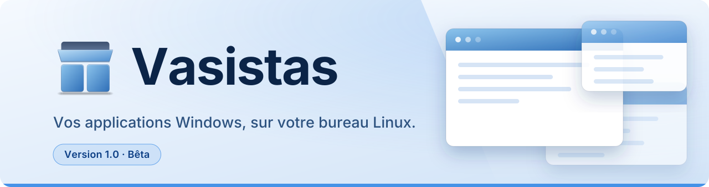
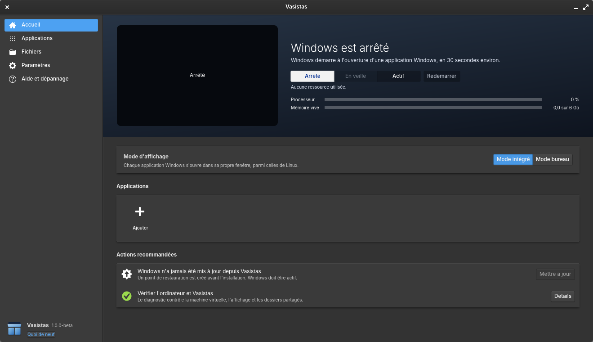

<p align="center">
  <picture>
    <source media="(prefers-color-scheme: dark)" srcset="docs/assets/en-tete-sombre.svg">
    
  </picture>
</p>

<p align="center">
  <a href="#installer">Installer</a> ·
  <a href="#ce-que-ça-change-au-quotidien">Fonctions</a> ·
  <a href="#windows-ce-quil-vous-faut">Windows</a> ·
  <a href="#vie-privée">Vie privée</a> ·
  <a href="#crédits">Crédits</a> ·
  <a href="docs/ARCHITECTURE.md">Architecture</a>
</p>

Vasistas fait tourner Windows en arrière-plan, dans une machine virtuelle, et ne montre que ce
dont vous avez besoin : vos applications. Word, Excel, Outlook ou Power BI s'ouvrent depuis le
menu Applications, ont leur icône dans le dock, et se déplacent, se redimensionnent et
s'alternent comme n'importe quelle autre fenêtre. Pas de bureau Windows à jongler, pas de
connexion à distance, pas de flux vidéo.

<p align="center">
  
  <br>
  <sub>L'accueil de l'application Vasistas : l'état de Windows, le mode d'affichage et les actions recommandées.</sub>
</p>

Pour qui ? Pour celles et ceux qui ont choisi Linux (elementary OS en priorité) mais dépendent
encore d'Office ou de Power BI. Vasistas est fait pour le travail de bureau, pas pour les jeux.

> **Version 1.0 (Bêta).** Vasistas fonctionne au quotidien mais reste en bêta : attendez-vous à
> des défauts, et gardez une copie de vos documents importants.

> **Un immense merci à [acceleration3](https://github.com/acceleration3).** La carte graphique
> accélérée de Vasistas, ce qui le rend fluide, est entièrement son travail : le pilote Windows,
> les pilotes Direct3D, Vulkan et OpenGL, le moteur de rendu côté Linux, tout cela vient de
> [accel-virt](https://github.com/acceleration3/accel-virt) et de
> [LSW](https://github.com/acceleration3/linux-subsystem-windows). Vasistas ne fait que
> l'intégrer à un bureau et à une application. Tout le mérite lui revient : allez voir et
> soutenir son projet.

## Ce que ça change au quotidien

- **De vraies fenêtres.** Chaque fenêtre de Windows est une fenêtre du bureau : icône dans le
  dock, place dans le sélecteur de fenêtres, menus et infobulles au bon endroit. Si vous voulez
  voir Windows en entier, le bouton « Afficher le bureau de Windows » l'ouvre dans une fenêtre.
- **Vos fichiers.** Documents et Téléchargements sont partagés avec Windows. Un double-clic sur
  un `.docx`, `.xlsx` ou `.pbix` dans Fichiers l'ouvre dans l'application Windows qui lui
  correspond.
- **Copier-coller, son, impression.** Le texte et les images passent dans les deux sens ; le son
  et le micro fonctionnent (le micro n'est lu que lorsqu'une application l'ouvre) ; vos
  imprimantes Linux sont disponibles dans Windows.
- **Fluide.** Windows dispose d'une carte graphique accélérée (voir plus bas) : l'affichage tient
  60 images par seconde, au lieu de 28 sans elle. La frappe apparaît en moins de 40 ms.
- **Économe.** Windows se met en pause quand vous ne l'utilisez pas et rend sa mémoire à Linux.
  Il reçoit moins de puissance sur batterie, plus quand Power BI est ouvert.
- **Deux façons de travailler.** *Mode intégré* (une fenêtre par application) ou
  *mode bureau* (tout Windows dans une seule fenêtre, à la résolution exacte de la
  fenêtre, barre des tâches comprise).
- **Plusieurs écrans.** Vous choisissez l'écran où s'ouvre chaque application. Vasistas retient
  la taille et l'écran de chacune, et « Réinitialiser les affichages » remet tout en place.
- **Un bureau cohérent.** Windows suit votre mode sombre et votre couleur d'accent. Ses
  notifications deviennent celles du bureau, et les icônes de sa zone de notification
  (OneDrive, Teams…) apparaissent dans le panneau.
- **Sans mauvaise surprise.** Un point de restauration est créé avant l'allègement de Windows
  et, si vous le voulez, avant chaque mise à jour ou installation. On revient en arrière en un
  clic.
- **Un tableau de bord et un diagnostic.** L'application Vasistas démarre ou arrête Windows,
  choisit les applications du menu et les types de fichiers à ouvrir, allège Windows, cherche
  les mises à jour, et lance un diagnostic qui répare ce qu'il peut et produit un rapport sans
  donnée personnelle.
- En français et en anglais.

## Installer

1. Téléchargez `vasistas-<version>.tar.gz` depuis la [dernière version publiée](../../releases),
   puis :
   ```
   tar xf vasistas-*.tar.gz
   cd vasistas-*
   ./install.sh
   ```
   Le script installe Vasistas dans votre dossier personnel, sans droits d'administrateur. S'il
   manque des paquets, il affiche la commande `sudo apt install …` à lancer.
2. Ouvrez « Vasistas » depuis le menu Applications.
3. Suivez l'assistant. Vous choisissez la langue, l'image de Windows, les applications ;
   l'installation se fait ensuite d'un seul clic : Windows, sa configuration, vos applications,
   le pilote graphique, les mises à jour.

**Il vous faut :** un processeur avec la virtualisation matérielle activée (KVM), 16 Go de
mémoire conseillés, environ 100 Go de disque libre, elementary OS 8 ou 9 (ou un système basé sur
Debian ou Ubuntu 24.04 et suivants avec GTK 4 et Granite 7 ; seul le bureau Pantheon est testé).

## Windows : ce qu'il vous faut

**Vous utilisez l'image de Windows que vous voulez.** Vasistas ne fournit aucun Windows : vous
téléchargez l'ISO sur le site de Microsoft (ou vous prenez la version d'évaluation de 90 jours,
que l'assistant sait télécharger) et vous la désignez dans l'assistant. Vous pouvez aussi
préparer un Windows déjà installé : voir [docs/configure-windows.md](docs/configure-windows.md).

**L'édition Professionnelle (Pro) est recommandée au minimum.** C'est un conseil technique :
l'édition Famille peut tourner dans une machine virtuelle, mais elle n'a pas toutes les
fonctions de gestion sur lesquelles Vasistas s'appuie (Bureau à distance, réglages de groupe).

**Les licences sont les vôtres**, et il en faut une par installation de Windows : une clé déjà
utilisée par un Windows installé sur le même ordinateur ne couvre pas en plus la machine
virtuelle. Il en va de même pour Office, Microsoft 365 et les autres logiciels payants : leur
licence doit couvrir la machine virtuelle.

**La version d'évaluation de 90 jours** (Windows 11 Entreprise, compte Microsoft exigé) sert à
essayer Vasistas. Microsoft en interdit l'usage en production et après la période d'essai.

Pour installer sans saisir de clé tout de suite, l'assistant utilise une clé d'installation
générique publiée par Microsoft : elle choisit seulement l'édition et n'active pas Windows.
Activez-le ensuite avec votre propre clé (Paramètres, Système, Activation).

**L'installation contourne les contrôles de Windows 11** sur le TPM, Secure Boot et la mémoire
vive (réglage `LabConfig` de Microsoft), puisque la machine virtuelle n'en a pas. Ce n'est pas
un contournement de l'activation, qui reste à faire avec votre licence.

**L'allègement de Windows est facultatif.** Il retire des applications préinstallées et réduit
la télémétrie au minimum que permet votre édition (la coupure totale n'existe que sur
Entreprise et Éducation). Il s'appuie sur la liste de Win11Debloat, dont l'auteur rappelle
qu'on l'utilise à ses risques ; un point de restauration est créé avant.

## Ce que Vasistas n'est pas

- **Pas fait pour les jeux** ni pour la 3D exigeante ; les systèmes anti-triche refusent en
  général les machines virtuelles.
- **Pas de webcam** ni de périphériques USB directs pour l'instant.
- **Netteté sur plusieurs écrans.** Windows n'a qu'une seule échelle d'affichage. Si vos écrans
  en ont deux différentes, les fenêtres de l'un peuvent paraître floues. Préférez les échelles
  entières (100 %, 200 %) et gardez ensemble les applications utilisées ensemble.

## Carte graphique accélérée

Windows croit disposer d'une vraie carte graphique : DWM, Direct3D, Vulkan et OpenGL
s'exécutent sur la carte de votre ordinateur. **Ce travail n'est pas celui de Vasistas.** Il
est entièrement dû à **[acceleration3](https://github.com/acceleration3)**, auteur d'
[accel-virt](https://github.com/acceleration3/accel-virt) (pilote WDDM `avgpu`, pilotes
Direct3D 9 à 12, Vulkan, OpenGL et OpenCL pour Windows, dispositif QEMU et moteur de rendu
`av-renderer` pour Linux) et de [LSW](https://github.com/acceleration3/linux-subsystem-windows).
Sans lui, Vasistas serait resté à 28 images par seconde. Vasistas le récupère depuis le dépôt
de son auteur, le compile sur votre ordinateur, et l'assistant l'installe dans Windows en
citant son auteur à cette étape. Vasistas n'en distribue ni les sources ni les binaires.

> **Risques du mode « signature de test ».** Le pilote exige ce mode de Windows, une option
> prévue par Microsoft pour les pilotes en développement. Tant qu'il est actif, un pilote
> signé par n'importe qui peut se charger dans le noyau de Windows ; Windows affiche un
> filigrane « Test Mode », Secure Boot peut devoir être désactivé, et certaines protections
> (anti-triche, DRM) refusent de fonctionner. Pour revenir en arrière : « Retirer le pilote »
> dans l'application, `bcdedit /set testsigning off` dans Windows, ou le point de
> restauration créé avant l'installation.

> **Licence d'accel-virt.** Son dépôt n'a pas encore de licence publiée : j'ai demandé à son
> auteur de bien vouloir en choisir une
> ([issue n° 1](https://github.com/acceleration3/accel-virt/issues/1)) et j'attends sa réponse.
> D'ici là, Vasistas ne l'embarque ni ne le redistribue : c'est vous qui le compilez, sur votre
> ordinateur, depuis son dépôt. Si l'auteur préfère qu'il n'en soit pas ainsi, Vasistas le
> retirera.

Détails et mesures : [docs/acceleration-graphique.md](docs/acceleration-graphique.md).

## Vie privée

Vasistas ne collecte rien et n'envoie rien à personne. Il contacte seulement GitHub (pour
chercher les mises à jour, ce qui lui montre votre adresse IP), les sites de Microsoft (image de
Windows, applications) et Fedora (pilotes virtio-win). Le rapport de diagnostic est anonymisé,
et c'est vous qui décidez de le partager.

## Fonctionnement

Windows tourne dans une machine virtuelle QEMU/KVM. Vasistas lit l'écran de Windows directement
dans la mémoire partagée de QEMU : rien n'est encodé ni envoyé sur un réseau. Un petit agent
dans Windows indique où se trouve chaque fenêtre et transmet souris, clavier et presse-papiers
par un canal virtio. Côté Linux, chaque fenêtre Windows devient une fenêtre GTK 4 qui porte
l'identité de son application, pour que le bureau la regroupe et la décore correctement. Les
dossiers sont partagés par virtio-fs.

Détails : [docs/ARCHITECTURE.md](docs/ARCHITECTURE.md) et [PROTOCOL.md](PROTOCOL.md).

## Ligne de commande

```
vasistas vm start|stop|status          # la machine virtuelle
vasistas launch-app winword            # une application connue
vasistas open ~/Documents/rapport.docx # un fichier, dans son application Windows
vasistas files list|set csv excel      # types de fichiers ouverts dans Windows
vasistas folders list|link|unlink      # dossiers de Windows reliés à des dossiers Linux
vasistas exec 'Get-Process'            # un script PowerShell dans Windows
vasistas companion                     # l'application Vasistas
```

## Avec Lucarne

[Lucarne](https://github.com/Melvin-Cwz/lucarne) ouvre les applications web de Microsoft 365
dans des fenêtres du bureau. Les deux projets sont indépendants et ne partagent aucun code ;
installés ensemble, ils communiquent par leurs commandes (`vasistas launch`, `lucarne status`,
`lucarne config`). L'application Vasistas affiche alors une section « Navigateur » dans ses
Préférences.

## Développement

L'hôte est écrit en Python avec GTK 4 et Granite (`host/vasistas`), l'agent Windows en C# pour
.NET Framework 4.8 (`guest/Vasistas.Agent`). `./check.sh` lance les tests et compile l'agent ;
`tools/make-release.sh` prépare l'archive d'une version.

## Crédits

Vasistas est l'œuvre de Melvin Couwez. Il n'existerait pas sans le travail d'autres personnes :

- **[acceleration3](https://github.com/acceleration3)**, avant tout autre : [accel-virt](https://github.com/acceleration3/accel-virt)
  et [LSW](https://github.com/acceleration3/linux-subsystem-windows), le pilote graphique de
  Windows, ses pilotes Direct3D, Vulkan, OpenGL et OpenCL, et le moteur de rendu qui donnent à
  Vasistas sa fluidité. Tout le mérite de l'accélération graphique lui revient.
- **[QEMU](https://www.qemu.org)** et **KVM** : la machine virtuelle.
- **[virtio-win](https://github.com/virtio-win/kvm-guest-drivers-windows)** (Red Hat et
  contributeurs, projet Fedora) : les pilotes de Windows pour la machine virtuelle, dont
  viogpudo (Vadim Rozenfeld, Red Hat) que Vasistas modifie.
- **Philip Rebohle** ([DXVK](https://github.com/doitsujin/dxvk)) et **Hans-Kristian Arntzen**
  ([vkd3d-proton](https://github.com/HansKristian-Work/vkd3d-proton), dérivé de vkd3d, projet
  Wine) : Direct3D sur Vulkan, utilisés par accel-virt.
- **[Chris Lalancette](https://github.com/clalancette/pycdlib)** : pycdlib, qui construit le CD
  d'installation.
- **[Meta](https://github.com/facebook/zstd)** : zstd (licence BSD), la compression des images
  de fenêtres.
- **Roman Roemer et l'équipe [FlaUI](https://github.com/FlaUI/UIAutomation-Interop)** : les
  types d'interopérabilité UI Automation.
- **[Raphire](https://github.com/Raphire/Win11Debloat)** : la liste d'applications de
  Win11Debloat, qui guide l'allègement de Windows.
- **[elementary OS](https://elementary.io)**, **GTK** et **Granite** : le bureau et les
  bibliothèques de l'interface ; **PipeWire** pour le son, **CUPS** pour l'impression.
- **[Inter](https://rsms.me/inter/)** (Rasmus Andersson, licence OFL) : la police de l'en-tête.

Les licences sont reproduites dans [THIRD_PARTY_NOTICES.md](THIRD_PARTY_NOTICES.md).

## Licence

Vasistas est publié sous licence MIT (voir [LICENSE](LICENSE)), **sauf le dossier `patches/`**,
dont les correctifs de QEMU gardent la licence GPL 2.0 de QEMU. Les autres composants tiers
gardent aussi leur propre licence : pycdlib (LGPL 2.1, dans `host/vendor`, non modifié), zstd
(BSD), Interop.UIAutomationClient (MIT) et le correctif de viogpudo (BSD 3 clauses, copyright
Red Hat).

Windows, Office, Power BI et les autres logiciels cités appartiennent à leurs éditeurs.
Vasistas ne contient aucun logiciel ni licence de Microsoft (seule la capture d'écran montre
Word, avec un document fictif) : leurs images et
installateurs se téléchargent sur leurs sites officiels, et leur usage reste soumis à leurs
conditions. Vasistas est un projet indépendant, sans lien avec Microsoft ni approbation de sa
part.

Excel, Microsoft, Outlook, Power BI, Windows et Word sont des marques du groupe Microsoft.
QEMU est une marque de Fabrice Bellard. Les autres noms cités appartiennent à leurs
propriétaires.
